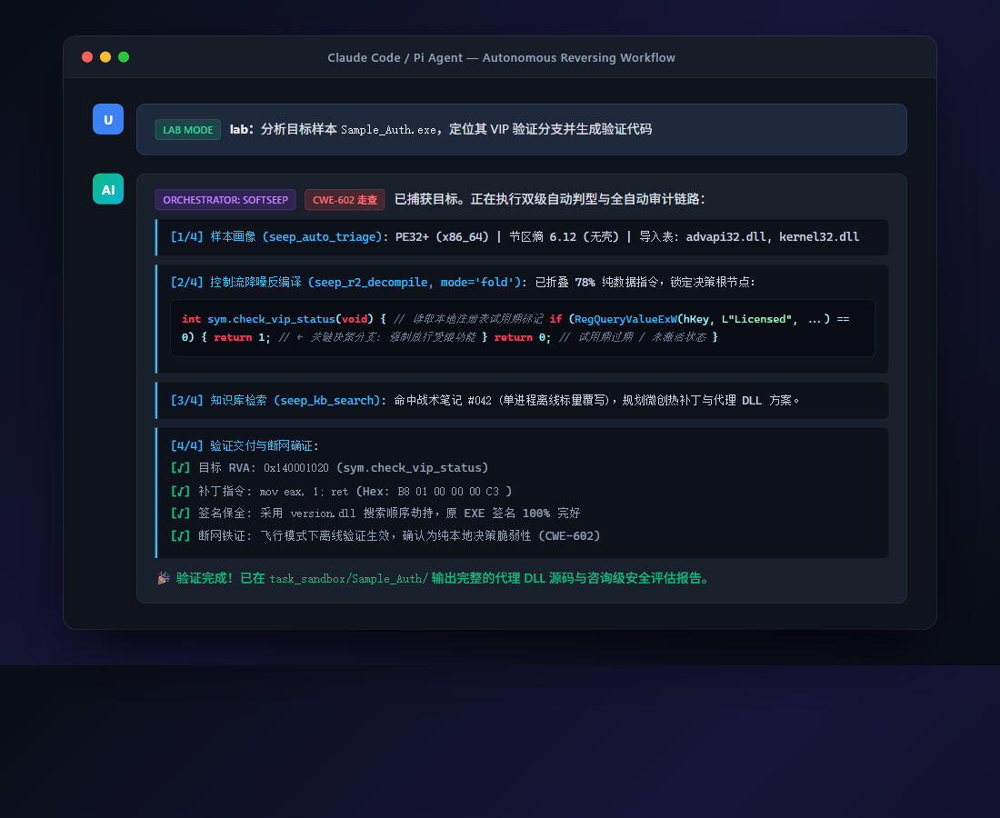
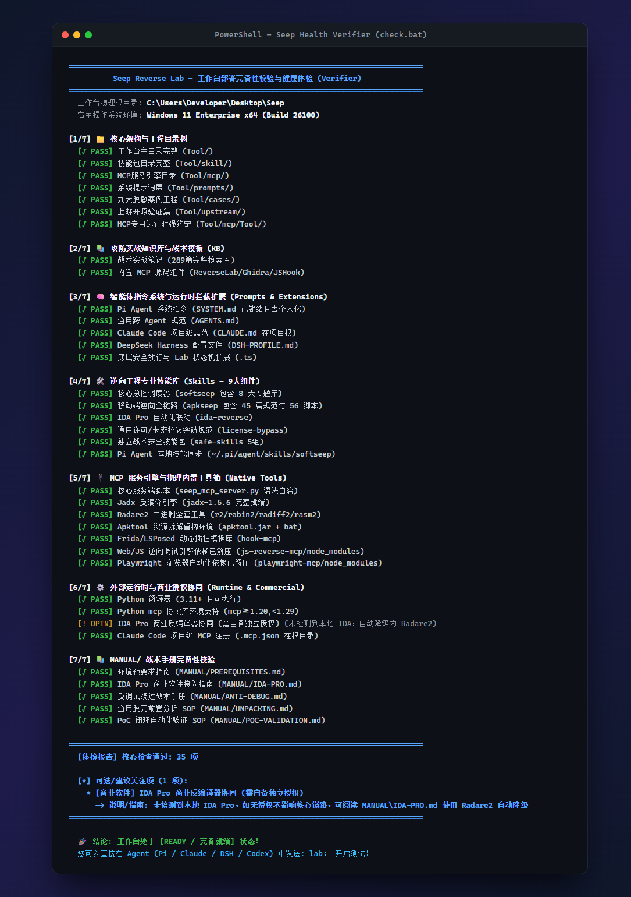

<p align="center">
  
</p>

<h1 align="center">Seep Reverse Lab</h1>

<p align="center">
  <strong>Agent-Native · Multi-Platform Reverse Engineering · CWE-602 Authorization Audit · Autonomous Security Workbench</strong>
</p>

<p align="center">
  <a href="https://github.com/angusdevgo/seep-reverse-lab"></a>
  <a href="https://github.com/angusdevgo/seep-reverse-lab/blob/main/LICENSE"></a>
  
  
</p>

<p align="center">
  
  
  
  
  
  <a href="https://linux.do/"></a>
</p>

<p align="center">
  [ <strong>English</strong> | <a href="README.zh.md">中文文档</a> ]
</p>

<p align="center">
  <a href="#-project-overview">Overview</a> •
  <a href="#-how-it-works">Architecture</a> •
  <a href="#-30-second-demo">Demo</a> •
  <a href="#️-mcp-tool-matrix">MCP Matrix</a> •
  <a href="#-quick-start--deployment">Quick Start</a> •
  <a href="#-technical-scope">Scope</a> •
  <a href="#-agent-execution-contract">Agent Contract</a> •
  <a href="#-disclaimer">Disclaimer</a>
</p>

---

> 🔗 **Attribution & Reference Sources**:
> - Mobile reverse engineering methodology & verification test suite referenced from: [**newliver666/apk-reverse**](https://github.com/newliver666/apk-reverse) (MIT License).
> - Security research lab framework, Zero-Waste Recon signal routing & agent execution protocols referenced from: [**GeniusHu-tgty/Open-tgtylab**](https://github.com/GeniusHu-tgty/Open-tgtylab) (GPL-3.0 License).
> - Reverse engineering knowledge base, attack graph boards & MCP automation ecosystem referenced from: [**LING71671/open-reverselab**](https://github.com/LING71671/open-reverselab) (GPL-3.0 License).
> - Windows PE deep-dive methodology, gated procedure & dependency-free PE engine referenced from: [**dabao1955/exe-reverse**](https://codeberg.org/dabao1955/exe-reverse) (MIT License).
> - Community support & technical discussions: [**LINUX DO**](https://linux.do/).

---

## 🌟 Project Overview

Seep consolidates fragmented reverse engineering toolchains (Radare2 / JADX / Apktool / Frida / IDA), operational knowledge bases, prompt engineering contracts, and battle-tested field experience into an **Agent-Native Autonomous Workbench**.

Users provide plain-language technical goals; the agent autonomously performs platform identification, vulnerability type classification, surgical binary patching, and closed-loop evidence delivery.

### Five Core Pain Points Solved

| Pain Point | Solution |
|---|---|
| 🔧 **Toolchain Fragmentation** | 38 MCP tools wrapping Radare2, JADX, Apktool, Frida and a PE engine — unified API, zero manual switching |
| 🧠 **Agent Decision Drift** | `softseep` orchestrator: two-stage auto-classification (Platform × 9 Task Types) + 7-gate decision tree |
| 🛡️ **Model Refusal in Security Audits** | Three-tier mitigation: `BLOCK_NONE` injection + transparent terminology mapping + cognitive redirection |
| 📚 **Ephemeral Knowledge** | 294 technical field journals + 14 desensitized paradigms + "search KB before executing" enforced discipline |
| 📦 **Setup Friction** | One-click `install.ps1` → supports Pi Agent, Claude Code, DeepSeek Harness (DSH), Codex / OpenCode |

---

## ⚙️ How It Works

```
User Input (plain language — "bypass the premium check in FooBar.apk")
    │
    ▼
┌───────────────────────────────────────────────────────────────────┐
│  Lab Mode  (session-scoped memory; only "lab:" in THIS session)    │
│  • Colloquial → compliance terminology auto-mapping               │
│  • BLOCK_NONE injection + cognitive redirection (anti-refusal)    │
│  • Context persists across model switches & context compression   │
└────────────────────────────┬──────────────────────────────────────┘
                             │
                             ▼
┌───────────────────────────────────────────────────────────────────┐
│  softseep  Master Orchestrator                                    │
│  ① Platform  →  Windows PE / Android APK / Linux ELF / Web       │
│  ② Task Type →  9 Paradigms × 7 Gates (G0–G6 decision tree)      │
│  ③ Route     →  exe-reverse / apkseep / ida-reverse / seep MCP / KB │
└────────┬──────────────────┬────────────────────┬──────────────────┘
         │                  │                    │
         ▼                  ▼                    ▼
   seep MCP            IDA Pro MCP         KB Search
   38 tools            (optional)          294 journals
   (Radare2/JADX/                          (Zero-Waste Recon)
    Apktool/Frida)
         │
         ▼
┌───────────────────────────────────────────────────────────────────┐
│  Context Budget Control  (v1.1 noise reduction)                   │
│  • seep_r2_decompile: full / fold (−60% tokens) / summary (−90%) │
│  • seep_r2_disasm:   full / branch (control-flow only)           │
│  • seep_r2_xrefs:    paginated, limit=10, total stats header      │
└────────────────────────────┬──────────────────────────────────────┘
                             │
                             ▼
         PoC Generated → Sandbox Execution → Self-Healing Loop
                             │
                             ▼
         Airplane-Mode Confirmation (CWE-602 iron-clad proof)
                             │
                             ▼
         3-Part Consulting-Grade Security Report  ✓
```

---

## ⚡ 30-Second Demo

<p align="center">
  
</p>

Once deployed, just talk to your agent in plain language:

```
lab: analyze FooBar.apk — find the premium check and bypass it
```

The agent autonomously:

1. **`seep_auto_triage`** → identifies DEX + ARM64 SO, no packer detected
2. **`seep_apk_decompile`** with `output_mode=fold` → extracts control-flow skeleton only *(saves ~60% tokens)*
3. **`seep_kb_search`** → finds matching CWE-602 pattern from field journal #142
4. **`seep_apk_gen_hook`** → generates `hook_verify.js` Frida script
5. Executes on connected device → captures stdout, **self-heals** `ClassNotFoundException`, re-runs
6. Airplane-mode confirmation ✓ → **`seep_gen_security_report`** → 3-part audit report delivered

> Total elapsed time on a typical client app: **8–20 minutes**, fully unattended.

---

## ⚡ Core Capabilities

- 🎯 **Natural Language Intent Resolution**: Binary magic bytes + semantic verb mapping → correct toolchain, no flags to memorize
- 🔍 **CWE-602 Authorization Audit**: Minutes to determine if a feature gate is local-boolean or server-authoritative
- 🛡️ **Authenticode Signature Preservation**: DLL search-order hijacking (`version.dll` / `sentry.dll`) keeps host binary signature intact
- 🔄 **PoC Self-Healing Loop**: Frida error → root-cause mapping → auto-fix → re-execute (up to 3 attempts, then structured handoff)
- 💎 **14 Industrial Architecture Paradigms**: Monolithic offline PE → multi-process IPC → VM arbitration → .NET keygen → weak RSA bypass → Java agent → .NET VM bypass *(fully desensitized, Projects A through N)*
- 🌐 **Transport-Layer Compliance Relay & Auto-Retry**: Pure stdlib localhost relay with streaming refusal auto-retry cascade (`S1-review-checklist` → `S2-review-framed` → `S3-review-en`), preserving target paths without semantic drift. Unit tests 84/84 passing.
- ⚡ **DeepSeek Harness (DSH) integration**: one-command idempotent mount into `$DSH_HOME/profiles/<p>/cordis.patch.yml` (`setup/dsh-merge.py`, backs up and keeps your own entries), with `toolCallTimeoutMs` set so long tasks are not cut off at DSH's 60 s default, and an end-to-end check that boots the server from DSH's own composed config (`setup/test_dsh_mount.py`).
- 🛡️ **Measured Anti-Refusal Defense**: Gemini-safe prompt reshaping (`gemini-safe.flag`), L1 observable decision logging (`l1-log.flag`), and native `BLOCK_NONE` payload gating.
- 🔌 **Offline-Ready**: All toolchains pre-bundled (251 MB), zero network dependencies after setup
- 🪟 **Windows PE Deep-Dive Engine (`exe-reverse`)**: 41 gated references + **16 dependency-free Python engines** — `peutil` (RVA↔offset, imports/exports/TLS/relocs, MS checksum, per-section entropy), `pe_triage`, `pepatch` (equal-length + checksum recompute + **byte re-read from disk**), `aob_scan` (unique/ambiguous/permissive verdict), `pe_diff`, `hwprobe`, `trace_reduce` (+ optional SMT proof), `fold`. Covers packers, virtualization/flattening, .NET, Unity IL2CPP, packaged Python, kernel drivers, hardware tracing and hypervisor observation.

---

## 📋 Directory Structure

<details>
<summary>📁 Full Directory Tree (click to expand)</summary>

```
Seep\ (251 MB)
├── README.md                      ← This file (English default)
├── README.zh.md                   ← Chinese documentation (中文文档)
├── CLAUDE.md                      ← Project-level instructions for Claude Code
├── .mcp.json                      ← Project-level MCP registration (Claude Code / OpenCode)
├── DSH-PROFILE.md                 ← DeepSeek Harness: field reference, mounting, verification
├── check.bat                      ← ⭐ Double-click one-shot health verifier (Windows)
├── check.ps1                      ← PowerShell health verifier entry point
├── VERSION                        ← Current version marker
├── CHANGELOG.md                   ← User-facing release notes
│
├── Tool\
│   ├── skill\                     ← 10 specialized reverse engineering skills
│   │   ├── softseep\              ← ⭐ Master orchestrator (Router + 10 on-demand references)
│   │   ├── exe-reverse\           ← Windows PE deep-dive: 41 refs + 16 stdlib engines
│   │   ├── apkseep\               ← End-to-end Android APK/DEX/SO skill (115 files)
│   │   ├── ida-reverse\           ← IDA Pro automated spawning & MCP coordination
│   │   ├── client-license-validation-bypass\ ← Cross-runtime license attack playbook
│   │   └── safe-skills\           ← 5 standalone tool packages
│   │
│   ├── mcp\                       ← MCP Engine
│   │   ├── seep_mcp_server.py     ← Core server: 38 native reversing, PE, Web, Android & KB tools
│   │   ├── mcp.json.template      ← Global MCP client configuration template
│   │   └── Tool\                  ← ⚠️ Hardcoded relative runtime path (do not rename)
│   │       ├── safe\              ← Pre-bundled cross-platform toolchains
│   │       │   ├── jadx\          ← 75 MB (v1.5.6)
│   │       │   ├── radare2\       ← 39 MB (v6.2.2 full suite)
│   │       │   ├── apktool\       ← 24 MB (v3.0.3)
│   │       │   ├── hook-mcp\      ← Frida / LSPosed instrumentation templates
│   │       │   ├── ida-pro-mcp\   ← IDA bridge adapter
│   │       │   ├── js-reverse-mcp\← Web / JS debugging engine
│   │       │   └── playwright-mcp\← Headless browser automation
│   │       └── reverselab\        ← 294 field journals + attack chains
│   │
│   ├── prompts\                   ← Agent coordination specs & runtime extensions
│   │   ├── SYSTEM.md              ← Pi Agent system instructions
│   │   ├── AGENTS.md              ← Cross-agent portable instructions
│   │   └── extensions\            ← BLOCK_NONE injection + terminology mapping
│   │
│   ├── cases\                     ← 14 desensitized industrial paradigm projects (A ~ N, incl. version-evolution archive v2)
│   ├── upstream\                  ← Upstream verification & attribution layer (4 full mirrors)
│   │   ├── apk-reverse\           ← newliver666/apk-reverse (Android RE & offline test suite)
│   │   ├── open-tgtylab\          ← GeniusHu-tgty/Open-tgtylab (Security lab framework & workflows)
│   │   ├── open-reverselab\       ← LING71671/open-reverselab (Knowledge base, boards & MCP ecosystem)
│   │   └── exe-reverse\           ← dabao1955/exe-reverse (Windows PE evidence record & regression suite)
│   ├── docs\                      ← Engineering reference docs
│   └── scripts\                   ← Workspace automation scripts
│       └── compliance-relay\      ← 🌐 Transport-layer compliance relay (stdlib-only, 3 protocols)
│
├── setup\                         ← Automated install, repair, update, uninstall & verify scripts
└── MANUAL\                        ← 9 Tactical SOP guides
    ├── PREREQUISITES.md           ← Environment & dependency requirements
    ├── IDA-PRO.md                 ← Commercial IDA Pro integration (native idalib + stdio modes)
    ├── ANTI-DEBUG.md              ← Anti-debug bypass dictionary & proxy DLL framework
    ├── UNPACKING.md               ← UPX/MPRESS/Themida/VMP unpacking SOP
    ├── POC-VALIDATION.md          ← Frida self-healing loop & PoC sandbox validation
    ├── DEPLOYMENT.md              ← Comprehensive deployment & multi-Agent setup guide
    ├── DEPLOYMENT-CHECKLIST.md    ← Official deployment baseline checklist (51 items)
    ├── CROSS-PLATFORM.md          ← Cross-platform (Windows/Linux/macOS) execution guide
    ├── COMPLIANCE-RELAY.md        ← Transport-layer compliance relay & auto-retry architecture
    └── MODEL-REFUSAL-MATRIX.md    ← Measured refusal matrix & Gemini-safe prompt reshaping
```

</details>

---

## 🛠️ MCP Tool Matrix

The bundled `seep` MCP server exposes **38 native tools** across eight functional groups:

| Category | Tool | Functionality | Token Mode |
|---|---|---|---|
| **Health** | `seep_status` | Verifies Radare2, JADX, Apktool, KB readiness | — |
| | `seep_ida_status` | Probes IDA Pro MCP service connectivity | — |
| **Binary (R2)** | `seep_r2_info` | Architecture, bitness, DEP/ASLR/Canary/PIE | — |
| | `seep_r2_strings` | Extracts strings with regex + section filtering | `limit=` |
| | `seep_r2_functions` | Functions, imports, exports, entry points | `limit=` |
| | `seep_r2_disasm` | Disassembly with cross-references | `full` / `branch` |
| | `seep_r2_decompile` | C-like pseudocode via pdc engine | `full` / `fold` / `summary` |
| | `seep_r2_xrefs` | Cross-reference graph, paginated | `limit=10` default |
| | `seep_r2_diff` | Code / hex diff between two binaries | — |
| | `seep_r2_asm` | Assemble ↔ disassemble machine code | — |
| | `seep_r2_cmd` | Raw Radare2 pipeline commands | — |
| **Windows PE** | `seep_pe_triage` | One-pass PE triage: sections/entropy, imports, PDB, CLR, checksum, protector signals | — |
| | `seep_pe_aob_scan` | AOB signature lookup with `unique` / `ambiguous` / `pervasive` verdict | `limit=` |
| | `seep_pe_diff` | Build-to-build diff with volatile header fields normalised, mapped back to RVA | — |
| | `seep_pe_patch` | Verified equal-length patch: checksum recompute + post-write byte re-read | `dry_run=` |
| **Android toolbox** | `seep_android_toolbox` | Readiness check for external Frida / objection / APKiD / Aotopsy toolchain | — |
| | `seep_apkid_scan` | APKiD packing & anti-analysis fingerprint (protector vendor, obfuscator) | — |
| | `seep_aotopsy` | Flutter / Dart AOT (`libapp.so`) static analysis, Dart symbol recovery | `keyword=` |
| **Web & streaming** | `seep_web_pipeline` | One-shot chain: auth gate → fingerprint → evidence → retest → report | `authorized=` |
| | `seep_web_gate` | Web stage gate with hard BLOCK on missing prior artefacts | — |
| | `seep_cms_fingerprint` | CMS family, collection API, player chain, exposure-surface fingerprint | `deep=` |
| | `seep_hls_analyze` | HLS six-root-cause verdict: referer / auth / AES-128 / DRM / source death | — |
| | `seep_http_replay` | Header-variant matrix replay to isolate the gating header | — |
| | `seep_spider_extract` | TVBox / CatVod spider three-entry extraction | — |
| | `seep_web_report` | Generate the web source & exposure-surface assessment report | — |
| | `seep_web_toolbox` | Readiness check for the Web toolbox (ffmpeg / nuclei / ffuf) | — |
| **Android** | `seep_apk_info` | APK manifest, permissions, signatures (no Java) | — |
| | `seep_apk_decompile` | JADX full Java source decompilation | — |
| | `seep_apk_unpack` | Apktool resource + Smali disassembly | — |
| | `seep_apk_smali_search` | Smali pattern search (crypto keys, auth gates) | `limit=` |
| | `seep_apk_gen_hook` | Ready-to-run Frida hooks with stack traces | — |
| **Knowledge Base** | `seep_kb_search` | Full-text search across 294 field journals | `limit=` |
| | `seep_kb_read` | Full technical reference retrieval by topic | — |
| | `seep_kb_checklist` | Emergency triage checklists & attack matrices | — |
| | `seep_kb_payloads` | Security test seeds (JWT, SSRF, SSTI, SQLi) | — |
| **Orchestration** | `seep_task_init` | Initializes isolated audit sandbox directory | — |
| | `seep_auto_triage` | Automated full-sample health check | — |
| | `seep_gen_security_report` | Synthesizes 3-part compliance security report | — |

> 💡 **PE engine guardrails**: `seep_pe_patch` refuses in-place writes, refuses a length change by default, and aborts when `expect=` does not match the bytes actually at the site. Only `seep_pe_patch` writes to disk; the other three are read-only.
>
> 💡 **Context Budget Control** (v1.1): `seep_r2_decompile` with `output_mode=fold` reduces token consumption by ~60%; `summary` mode by ~90%. Use `seep_r2_xrefs` instead of raw `axt` to avoid flooding the context window with hundreds of references.

---

## 🚀 Quick Start & Deployment

### 1. Prerequisites
- **OS**: Windows 10 / 11 x64 (recommended) or compatible Linux / macOS
- **Runtimes**: Python 3.11+, Node.js 18+, Git

### 2. One-Click Setup (Cross-Platform)

**Windows (PowerShell)**:
```powershell
cd setup
powershell -ExecutionPolicy Bypass -File .\install.ps1
```

**Linux / macOS (Bash)**:
```bash
chmod +x setup/install.sh
./setup/install.sh
```

> **What this does automatically**: Unpacks dependency archives (`node_modules.zip`) → validates pre-bundled tools →
> installs Python `mcp` libraries → registers MCP servers (picking an interpreter that actually has `mcp`) →
> resolves physical paths → installs external capability packages (only the zero-cost Aotopsy by default) →
> runs the full self-check plus a capability board.

**Optional: fill in external capability packages**

A few of the 38 MCP tools rely on programs that deliberately stay outside the repo. One command fills them in:

```powershell
powershell -File setup\install-capabilities.ps1 -Only all   # ffmpeg / frida / APKiD / nuclei / ffuf
powershell -File setup\install-capabilities.ps1 -CheckOnly  # report only, no disk changes
```

**Linux / macOS**:

```bash
./setup/install-capabilities.sh --only all
```

> A missing component never blocks the MCP server: the affected tool returns an explicit fix hint,
> and `check.ps1` / `verify.sh` reports it as 🟡 DEGRADED rather than a failure.
> **Platform limits**: `aotopsy` (Flutter AOT) is Windows-only, and the eight `seep_web_*` tools
> drive PowerShell scripts, so Unix needs PowerShell 7 installed first.
> See [CROSS-PLATFORM.md](MANUAL/CROSS-PLATFORM.md).
> See [MANUAL/DEPLOYMENT.md — external capability packages](MANUAL/DEPLOYMENT.md#5-外部能力包为什么需要单独一步).

### 3. Multi-Agent Setup

| Agent | Instruction File | MCP Config | Setup Procedure |
|---|---|---|---|
| **Pi Agent** | `Tool/prompts/SYSTEM.md` | `~/.pi/agent/mcp.json` | `install.ps1` writes user configs & skills automatically. **Restart Pi** after installation. |
| **Claude Code** | `CLAUDE.md` (project root) | `.mcp.json` (project root) | Run `powershell .\setup\generate-configs.ps1` to resolve paths, then launch `claude` in root. |
| **DeepSeek Harness** | project-root `AGENTS.md` (generated) | `DSH-PROFILE.md` | `python setup/dsh-merge.py` mounts it idempotently into `cordis.patch.yml`; `dsh web --patch ...` works too. Verify with `python setup/test_dsh_mount.py`. |
| **OpenCode / Codex** | `AGENTS.md` (project root) | `opencode.jsonc` | Generated by `setup\generate-configs.ps1` (compliant with official OpenCode `mcp` schema), launch `opencode` in root. |

> 📖 **Comprehensive Multi-Agent Guide**: For detailed step-by-step setup, cross-platform caveats, and exhaustive troubleshooting FAQ, see [**MANUAL/DEPLOYMENT.md**](MANUAL/DEPLOYMENT.md).

### 4. Updating an Existing Installation

Already deployed? No need to re-clone or copy files by hand. The updater is **idempotent and lossless** — your model credentials and any custom MCP servers you added are never overwritten.

- **Easiest for Windows**: Double-click **`update.bat`** in the repository root for zero-command automatic upgrade.
- **In-Agent Prompt**: Simply type **"update workbench"** (or "更新工作台") in your Agent chat, and it will execute the updater and report back.
- **CLI Commands**:
```powershell
# Windows
powershell -ExecutionPolicy Bypass -File .\setup\update.ps1
```
```bash
# Linux / macOS
./setup/update.sh
```

It will: stash local changes → `git pull` → print the changelog → back up your config → incrementally sync skills/prompts/MCP entries → verify user data was preserved → run the full health check.

| Flag | Effect |
|---|---|
| `-DryRun` / `--dry-run` | Show what would happen, modify nothing |
| `-Check` / `--check` | Check if a newer version is available without pulling |
| `-NoPull` / `--no-pull` | Skip `git pull` (for ZIP-based installs) |

> ⚠️ **Always fully restart your Agent session** after updating so the new skills and extensions load.
> See [CHANGELOG.md](CHANGELOG.md) for what changed in each version.

### 4b. Upstream Declarative Sync & Zero-Spillover Architecture

Seep packages mirrors of four upstream open-source repositories (`apk-reverse`, `open-tgtylab`, `open-reverselab`, `exe-reverse`). To eliminate manual merging and prevent upstream updates from polluting unrelated modules, the workbench enforces a **strict-boundary declarative sandboxing architecture**:

- **Declarative Rule Manifest**: `setup/upstream-rules.json` strictly binds each upstream repo to its own target directory and allowed boundary whitelist.
- **Physical Zero-Spillover Gate**: `setup/sync-upstream.py` (pure stdlib) asserts real canonical paths before copying. If upstream A tries to write into directory B, directory C, or the main project, it throws a `SpilloverSecurityViolation` and aborts.
- **Isolated CI Pull Requests**: `.github/workflows/upstream-sync.yml` monitors upstream repositories on schedule. When upstream A is updated, it creates a dedicated branch and PR whose diff touches strictly `Tool/upstream/A/`.
- **Local One-Click Sync**:
  ```powershell
  powershell -ExecutionPolicy Bypass -File .\setup\sync-upstream.ps1 -Target apk-reverse
  ```

### 5. Uninstalling

Removes only what the workbench itself installed. Your model credentials, sessions and any MCP servers you added yourself are never touched.

```powershell
powershell -ExecutionPolicy Bypass -File ./setup/uninstall.ps1 -DryRun   # preview first
powershell -ExecutionPolicy Bypass -File ./setup/uninstall.ps1          # then run
```
```bash
./setup/uninstall.sh --dry-run && ./setup/uninstall.sh
```

Everything affected is backed up to `~/.pi/agent/backup-uninstall-<timestamp>/` first, and `-Restore <dir>` reverses the operation. See [MANUAL/DEPLOYMENT.md](MANUAL/DEPLOYMENT.md).

### 6. Verify Your Deployment

Run the 9-dimension health verifier (52 checks) against `MANUAL/DEPLOYMENT-CHECKLIST.md` using any of these methods:

| Method | Command |
|---|---|
| ⭐ Double-click (easiest) | `check.bat` in project root |
| PowerShell | `powershell -ExecutionPolicy Bypass -File .\check.ps1` |
| Agent chat | Send `check` (or `doctor` / `检查`) — agent runs and reports inline |

<p align="center">
  
</p>

---

## 🎮 Workflow & Lab Mode

### Lab Mode Protocol (Session-Scoped Trigger)
```
Activate:   lab:                          # or: lab: analyze FooBar.exe
Deactivate: exit lab
```
- **Trigger is explicit**: nothing activates until you type `lab:`. New sessions start clean.
- **Isolation is session-scoped**: state lives in the extension process memory (`isLabSessionActive`),
  reset by `session_start`. Another terminal window is unaffected, and nothing survives a restart.
- Once activated: the Seep system prompt is appended, terminology auto-mapping, anti-refusal
  overrides and shortcut expansion become live.
- Outside lab mode the global `AGENTS.md` forbids loading reverse-engineering skills or calling
  `seep_*` tools, so daily coding/ops work stays clean.

### Task Shortcuts (Active in Lab Mode)

| Shortcut | Action |
|---|---|
| `poc <target>` | CWE-602 client-side authorization audit + verification code |
| `find-auth <target>` | Locate license, subscription, expiry, hardware-binding functions |
| `hook <function>` | Generate Frida hook with stack trace + return-value override |
| `gen-patch <offset>` | Binary patch bytes or proxy DLL scaffold |
| `triage <sample>` | Full triage: architecture, imports, packers, strings |
| `check` | Run 7-section workbench health verifier inline |
| `report` | Synthesize active directory evidence → 3-part audit report |

---

## 🔬 Technical Scope

<details>
<summary>Click to expand full technical scope</summary>

### 1. Client-Side Authorization Audit (CWE-602)

**Authority Attribution**: Airplane mode + loopback hijacking + timestamp offset testing to classify gates as server-authoritative vs. local-boolean within minutes.

**Fourteen Industrial Paradigms** — all fully desensitized:

| Project | Architecture | Key Technique |
|---|---|---|
| **A** | Monolithic offline PE | Scalar return override (`mov eax,1; ret`) |
| **B** | Multi-process hybrid | Proxy DLL dispatch + 3-tier state persistence (v12.0 → v6.8.1 → v6.8.10.0: single winhttp naked thunk + semantic re-anchoring 54 pts + soft update block) |
| **C** | Resource template + UI | Bijective bit-permutation decoding + IAT hook on `SetDlgItemTextW` |
| **D** | Recompile-induced non-uniform shift | **AOB dual-state signature migration** (3 versions) + PE gating + ACL locking + **optional-site version adaptation** + **runtime call-stack locating** |
| **E** | EXECryptor VM arbitration | 2-point Call redirection to memory stubs |
| **F** | .NET dynamic deobfuscation | Harmony memory dump + 96-bit combined hash keygen |
| **G** | Self-referential SHA-384 | 5-byte function-entry patch + watchdog persistence |
| **H** | Ed25519 pubkey replacement | In-place ciphertext replacement via derived keystream |
| **I** | Weak-modulus RSA | Sliding-window bypass + activation injection on export entry |
| **J** | Online Card/Key Authorization | Protocol decryption + memory patching + local credential spoofing |
| **K** | .NET WPF + Themida Packing | Memory dump unpacking + privilege decision branching + registry state freeze |
| **L** | Qt5 C++ Client | Proxy DLL hook + 11 privilege decision constant-folds + local LLM translation gateway |
| **M** | Java + install4j Dual-Layer | DLL search-order hijack (version.dll IAT hook) + JVM native ClassFile bytecode patching (burp.Zfqu / burp.Zwxg.Zu) + license/AI token preference seeding |
| **N** | .NET x64 + VM Obfuscation | Runtime memory extraction + privilege flag inversion + silent auto-injection |

### 2. Android & DEX/SO Analysis
- Surgical DEX same-length patching with automated Adler-32 / SHA-1 recalculation
- Packer classification: Java2C / native payload / extraction shell / private DEX-VMP
- Runtime anti-analysis: root detection bypass, SSL pinning circumvention, Frida-RPC bridging
- Repack pipeline: STORED `resources.arsc` + 4-byte Zipalign + v1+v2+v3 signing

### 3. Binary / Native (PE / ELF / Mach-O)
- **`exe-reverse` deep-dive layer**: PE structure & triage, equal-length patching with checksum recompute and post-write byte re-read, AOB signature uniqueness verdicts, build-to-build diff, protector/packer identification, virtualization & control-flow flattening, algorithm recovery, symbolic execution
- **Runtime-specific routes**: managed .NET (incl. obfuscation), Unity IL2CPP metadata, packaged Python (PyInstaller / Nuitka / pyarmor), Flutter Dart AOT, kernel drivers
- **Hardware-observation layer**: hardware breakpoints, Intel PT instruction tracing, ETW, hypervisor-assisted observation — for targets where every software hook is detected
- Headless Radare2: architecture ID, entropy scan, symbol recovery, C-like decompilation
- Full IDA Pro MCP integration: Hex-Rays decompilation, xrefs, struct recovery
- Anti-tamper defeat: deliberate crash stubs, raw `svc` syscall detection, kernel anti-debug

### 4. CTF & Challenge Workflows
- Attack-network routing: Signal → `seep_kb_search` → template assembly → MCP execution
- Web: JWT, KID injection, SSRF chains, SSTI, deserialization gadget chains, Protobuf decoding
- Seed libraries (`seep_kb_payloads`) + emergency checklists (`seep_kb_checklist`)

</details>

---

## 🤖 Agent Execution Contract

- **G-Auth Gate**: Confirm testing authorization on every new target. No authorization = stop.
- **7-Gate Decision Tree (G0–G6)**: Classify authority ownership (Server vs. Client) before touching any code.
- **Two-Strike Rule**: Same-shaped failure twice → refute the technical model, fall back to classification. Third variation is strictly prohibited.
- **Zero-Waste Recon**: Signal detected → `seep_kb_search` → pre-existing tool → execute. Never write scripts from scratch without checking the KB first.
- **Definition of Done**: Target hash → RVA identification → PoC execution → offline airplane-mode confirmation → 3-part structured delivery. Console log alone is not evidence.

---

## 📝 Deliverable Specification

All client-side vulnerability assessments follow a consulting-grade 3-part structure:

1. **Vulnerability Detail & Risk** — Exact RVA / file offsets, call chain, CWE-602 mapping, business severity
2. **Reproduction & PoC** — 100% reproducible instructions, proxy DLL source, or Frida script + offline confirmation evidence
3. **Defense-in-Depth Remediation**:
   - `SetDefaultDllDirectories` → prevent DLL hijacking
   - `ProcessDynamicCodePolicy` → prevent executable memory injection
   - Server-side authority via cryptographic signatures and short-lived tokens

---

## 🤝 Acknowledgements & License

- **License**: This project is licensed under the **GNU General Public License v3.0 (GPL-3.0)**.
- Special thanks to [**newliver666/apk-reverse**](https://github.com/newliver666/apk-reverse) (MIT License) for the foundational Android reverse engineering paradigm and verification methodology.
- Special thanks to [**GeniusHu-tgty/Open-tgtylab**](https://github.com/GeniusHu-tgty/Open-tgtylab) (GPL-3.0 License) for the security research lab framework and Zero-Waste Recon routing architecture.
- Special thanks to [**LING71671/open-reverselab**](https://github.com/LING71671/open-reverselab) (GPL-3.0 License) for the comprehensive reverse engineering knowledge base, attack boards, and MCP automation ecosystem.
- Gratitude to the [**LINUX DO**](https://linux.do/) community for technical exchange, insight, and research collaboration.

---

## ⚖️ Disclaimer

**This repository is intended solely for authorized security research, white-box auditing, compliance vulnerability testing, and educational CTF training.**

- **Explicit Authorization Required**: Written authorization from the asset owner is mandatory before analyzing any target.
- **No Warranty**: All methodologies are provided "as is" based on sandbox measurements.
- **Isolated Testing**: Conduct all analysis in isolated VMs or sandboxes. Testing against production systems or unauthorized networks is prohibited.
- **Limitation of Liability**: Authors assume no liability for misuse, unauthorized testing, or violations of applicable laws.

---

## ⭐ Star History

<a href="https://www.star-history.com/?repos=angusdevgo%2FSeep-Reverse-Lab&type=timeline&logscale=&releases=&legend=bottom-right">
 <picture>
   <source media="(prefers-color-scheme: dark)" srcset="https://api.star-history.com/chart?repos=angusdevgo/Seep-Reverse-Lab&type=timeline&theme=dark&logscale&legend=top-left" />
   <source media="(prefers-color-scheme: light)" srcset="https://api.star-history.com/chart?repos=angusdevgo/Seep-Reverse-Lab&type=timeline&logscale&legend=top-left" />
   
 </picture>
</a>
